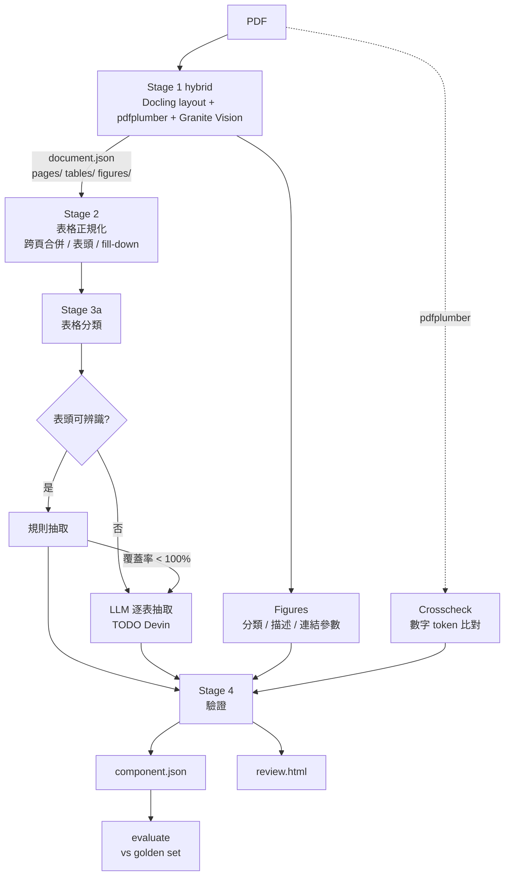

# 架構說明

## 1. 設計原則

1. **每一層都落地中間檔**。遺漏一定查得到發生在哪一層，不用整條重跑猜。
2. **LLM 逐表處理，不讀全文**。每列帶 `row_id`，輸出必須逐列交代，缺列會被自動重送或標記。
3. **規則優先，LLM 補漏**。表頭能辨識的表直接用規則抽，可重現、零成本、不會幻覺。
4. **原文永遠保留**。每個數值都有 `raw`，並帶 page + bbox，可以回到 PDF 原位確認。
5. **多道獨立防線**。覆蓋率、pdfplumber 雙路比對、關鍵參數清單、golden 評估，任一道抓到就標記 `needs_review`。
6. **圖不是數值來源**。Spec 數值以表格為準，圖只負責連結與描述。

## 2. 資料流



只有 Stage 1 需要 `docling` 與模型。Stage 2 以後只讀 `document.json`，可以在任何環境跑、測試、debug。

Stage 1 只有一種：hybrid（`stage1_hybrid.py`）。選擇依據見 `docs/METHOD_COMPARISON.md`（4 份 datasheet 上與 pdfplumber、Docling 單獨使用的比較；那兩者的程式已移除，結果封存在 `out/compare/`）。

## 3. 輸出目錄

```
out/<stem>/
├─ 01_docling/
│  ├─ document.json        DoclingDocument 完整輸出（Stage 2+ 唯一輸入）
│  ├─ document.md          快速瀏覽
│  ├─ meta.json            來源 sha256、docling 版本、pipeline options
│  ├─ pages/page_N.png
│  ├─ tables/table_N.png   review 對照用；也可送視覺 LLM 做第三路比對
│  └─ figures/figure_N.png
├─ 02_tables/
│  ├─ tables.json          正規化表格（每列有 row_id、kind、section）
│  └─ merge_log.json       哪些表被合併、原因
├─ 03_extract/
│  ├─ parameters.json
│  ├─ coverage.json        每張表每一列的去向
│  └─ llm_pending.json     LLM 未啟用時，等待 LLM 處理的表（含 prompt 預覽）
├─ 04_validate/
│  ├─ validation.json
│  ├─ crosscheck.json
│  └─ schema_errors.json
├─ diagnose.json           可疑遺漏清單
├─ <stem>.component.json   ← 最終產物
└─ review.html             人工審核頁
```

## 4. 各 Stage 說明

### Stage 1：hybrid（`stage1_hybrid.py`）

| 步驟 | 模組 | 說明 |
|---|---|---|
| 找表格與圖的位置 | `docling_layout.py` | Docling layout + TableFormer + 圖片分類（不跑 Docling 內建的圖片描述） |
| 有框線的表 | `pdf_ruled_tables.py` | pdfplumber 在 Docling 的表格範圍內依框線重建（結構與文字都來自 PDF）；表頭以粗體判斷；`y_tolerance` 把下標字合併回主字 |
| 沒有框線的表 | `stage1_hybrid.py` | Docling 的列／欄位置當格線，每格文字用 pdfplumber 在該範圍內的字 |
| 雙路比對 | `stage1_hybrid.py` | 與 Docling 原本的數字 token 差異 > `hybrid.disagreement_ratio` → `meta.json` 記 flag |
| 漏掉的框線表 | `stage1_hybrid.py` | 頁面上有框線、Docling 沒偵測到的表，用 pdfplumber 補上 |
| 圖片描述 | `vision_describe.py` | Granite Vision 3.3 2B + `prompts/figure_describe_hybrid.md`（帶入 caption 與圖內 PDF 文字）；頁首／頁尾的 logo、icon 不描述 |

設定在 `config/default.yaml` 的 `hybrid:`。Docling 的設定：

| 設定 | 預設 | 說明 |
|---|---|---|
| `do_ocr` | false | 數位 PDF 關閉，避免 OCR 把 µ、Ω、下標讀錯；掃描檔才開 |
| `table_mode` | accurate | TableFormer 精準模式 |
| `do_cell_matching` | false | true 會把預測格對回 PDF 文字格，合併儲存格多時容易錯 |
| `do_picture_classification` | true | 圖片分類器（logo、icon、line_chart…），hybrid 依此略過不需描述的圖 |
| `generate_page_images` | true | 截表格圖需要（`generate_table_images` 已 deprecated） |
| `visualize_layout` | false | debug 時打開，看 Layout 模型框到了什麼 |
| `artifacts_path` | — | 內網離線模型路徑 |

### Stage 2：表格正規化（`stage2_tables.py`）

- **grid 重建**：依 row/col span 展開成密集格。
- **多層表頭**：逐欄串接，例如「Limits / Min」；角色以最後一段優先判斷。
- **欄位角色**：parameter / symbol / conditions / min / typ / max / unit / value / notes，關鍵字在 config。
- **列類型**：data / section（整列分組標題，例如 Read Mode）/ repeated_header / empty。
- **fill-down**：只有「參數名稱格為空」才視為上一列合併儲存格的延續。有自己名稱的列不繼承 conditions，避免把別人的條件套進來。
- **跨頁合併**，滿足以下任一條件：
  - caption 含 continued 等字樣，且欄數相同
  - 相同 Table 編號，且欄數相同
  - 無 caption、中間沒有內文、欄數與表頭相同

  若 caption 寫 continued 但欄數不同，不合併，改標 `continuation_not_merged`。
- **註腳**：表格後方的 Notes 段落解析成 `{id: text}`，掛到參數上。

### Stage 3：定位與抽取（`stage3_locate.py`、`stage3_extract.py`）

- **分類**：caption（權重 3）、章節標題（權重 2）、表頭（權重 1）做關鍵字評分。
- **抽取範圍**：spec 類別的表，加上「未分類但有 min/typ/max 欄」的表。
- **規則抽取**：每列都會落在 `parameter | section | repeated_header | ignored:* | unmapped:*` 其中之一。
- **LLM 抽取**（`TODO(Devin)`）：
  1. 送單張表的 markdown，每列帶 row_id。
  2. 缺列時只把缺的列重送一次。
  3. 仍缺的列標為 `unmapped:llm_missing`。
  4. LLM 回傳的值必須在該列原文中找得到，否則加 `llm_value_not_in_source`。
- **範圍拆分**：Abs Max 的「-0.5 to 4.0」會拆成 min/max，原字串保留在 `value.raw`。

### Stage 4：驗證（`stage4_validate.py`、`crosscheck.py`）

- **JSON Schema**：`schemas/component.schema.json`。
- **合理性檢查**：
  - min ≤ typ ≤ max
  - 單位一致、單位缺漏
  - symbol 與單位類型相符（t* → s、V* → V、f* → Hz…）
  - 電壓絕對值 > 60V 視為不合理（ESD 參數除外）
- **衝突**：同 symbol + 同條件卻有不同值，常見原因是多料號或多電壓版本沒有分開。
- **關鍵參數清單**：`config/components/<type>.yaml` 中的 `expected_parameters`。
- **Crosscheck**：在每張表的 bbox 內，比對 pdfplumber 與 Docling 的數字 token。
- **diagnose**：PDF 文字層中，連續 ≥ 4 行含獨立數字、但不在任何表格內的區域，視為疑似整張表沒被偵測到。

## 5. 盲點對照表

| # | 盲點 | 發生層 | 本專案的對策 | 偵測方式 |
|---|---|---|---|---|
| 1 | 表格沒被偵測（被當 text 或 picture） | Layout | `diagnose` 找表外數字區；caption 為 Table 的 picture 標記 | `diagnose.json` suspects |
| 2 | TableFormer 漏格、錯併 | TableFormer | `do_cell_matching` 兩種設定比較；截圖對照 | crosscheck recall < 0.98 |
| 3 | 跨頁表格斷成兩張 | TableFormer | continued / 同表號 / 相鄰同欄數合併 | `merge_log.json` |
| 4 | 跨頁表頭重複被當資料 | Stage 2 | repeated_header 列 | coverage 狀態 |
| 5 | 多層表頭（Limits / Min） | Stage 2 | 表頭逐欄串接 + 角色辨識 | 欄位 role=other 會顯示在 review |
| 6 | 合併儲存格造成空白 | Stage 2 | 受限的 fill-down | `filled_down_from_merged_cell` |
| 7 | 註腳黏在數值上（2.0(1) → 2.01） | 正規化 | 上標保護 + 結尾註腳拆除 | notes 欄位 |
| 8 | µ / μ / u、Ω / Ω、各種負號 | 正規化 | 統一字元 | 單元測試 |
| 9 | 表達式值（0.7 x VCC） | 正規化 | value=None、保留 expr | `expression_value` |
| 10 | LLM 讀全文時漏列、改寫 | LLM | 逐表處理 + row_id 覆蓋率 + 缺列重送 | coverage < 1.0 |
| 11 | LLM 幻覺數值 | LLM | 值必須在原列中找得到 | `llm_value_not_in_source` |
| 12 | 同參數多條件（1.8V / 3.3V、不同溫度） | Schema | conditions + section 欄位 | `conflict_with` |
| 13 | 多料號共用一份 datasheet | Schema | part_numbers 陣列；衝突偵測 | `conflict_with` |
| 14 | Timing diagram 數值讀不準 | Figures | 數值以 AC 表為準，圖只連結 symbol | `symbols_in_figure_not_in_tables` |
| 15 | Typical 曲線被當規格 | Figures | 不數位化，僅分類 | — |
| 16 | 不知道整體漏了多少 | 治理 | golden set + 遺漏歸因 | `evaluate` |
| 17 | Datasheet 改版 | 治理 | sha256、docling 版本、config hash | `component.json` |
| 18 | NDA 文件外流 | 治理 | Docling 全本地；LLM / VLM 端點必須是內部的 | 人工確認 |
| 19 | 掃描檔、無文字層 | Stage 1 | `do_ocr: true`；crosscheck 失效時改用視覺 LLM 比對 | crosscheck token = 0 |
| 20 | 一張表大到超過 LLM context | LLM | `TODO(Devin)`：依列分批 | `llm_error` |
| 21 | 跨頁只用表格下方「Continued – next page」文字標示（無 caption） | Stage 2 | 兩表之間的文字含 continued 字樣也視為延續訊號 | `merge_log` reason=`continued_text_between` |
| 22 | ALT 替代符號欄（tCSS / tHO） | Stage 2 | `alt_symbol` 角色，關鍵參數比對同時查 alt | — |
| 23 | 一格合併橫跨 MIN/MAX | Stage 3 | 依 origin 欄判斷，視為單一 value | — |
| 24 | 封裝尺寸表有 Min/Nom/Max，被誤當規格 | Stage 3a | `package` 類別不抽 | — |
| 25 | 條件寫在參數名稱裡（「… (3.0V-3.6V)」） | Stage 3 | 規則無法拆；交給 LLM 或 EA 端用名稱比對 | conditions 為 null |
| 26 | 時序圖被當成表格（框線） | Stage 1 | Docling layout 判成圖的區域不補成表格；pdfplumber 框線結果以非空格比例過濾 | crosscheck 低 recall |

## 6. 擴充到其他元件

1. 新增 `config/components/<type>.yaml`，內容包含 `part_number_patterns` 與 `expected_parameters`。
2. 若該類元件有特殊表格名稱，在 yaml 裡覆寫 `locate.categories`。
3. 準備 5 份 golden set，跑 `evaluate`。

Schema 本身不分元件類型。元件差異只放在「關鍵參數清單」，避免每加一種元件就要改 schema。

## 7. 與後續系統的介面

- **EA 自動審查**：讀 `parameters`，以 `symbol` + `conditions` 查值，使用 `value_si` 比較。`needs_review=true` 的 datasheet 不應自動判 pass/fail。
- **工程師 chatbot**：`tables`（含 markdown 可重建）與 `figures.description` 可做 RAG。每筆都帶 page 與 bbox，回答可以附上原文位置。
